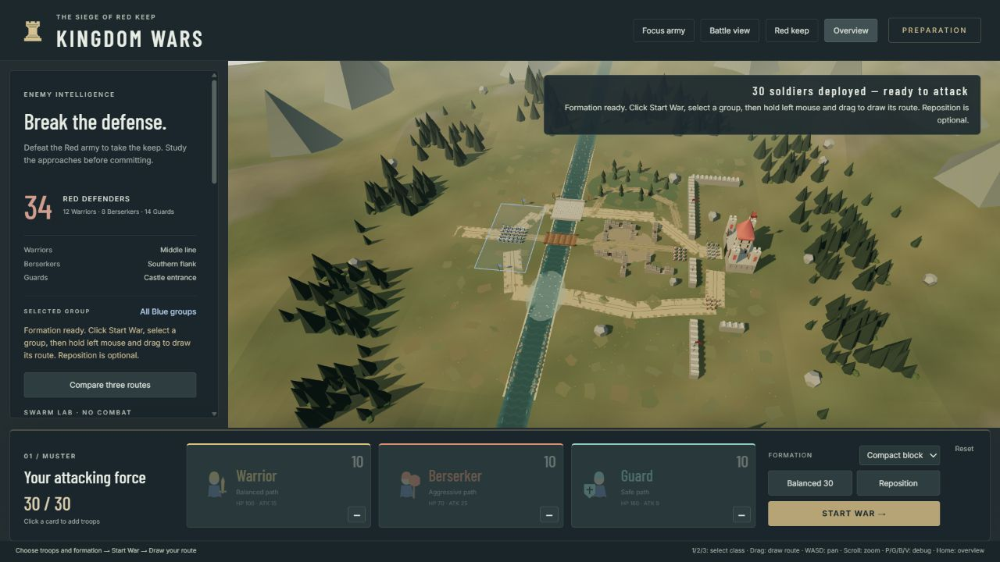
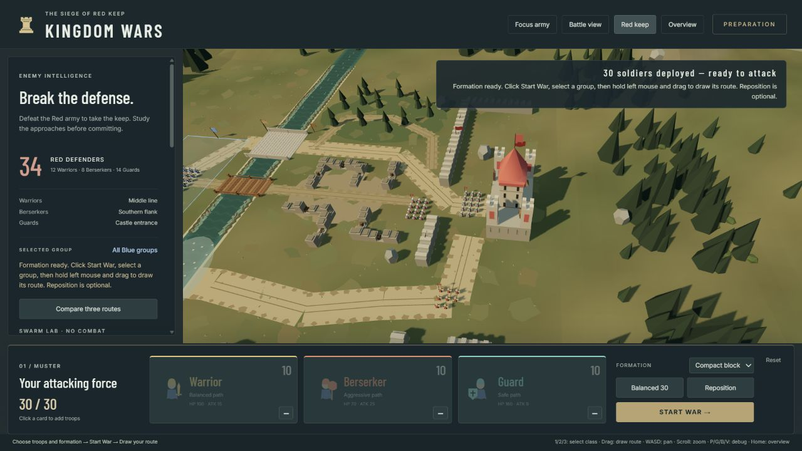

# Visual polish delivery — October 12, 2026

The existing Three.js/Vite battlefield has been polished in place. No framework or asset-pack dependency was added. Source backup: `before-visual-polish-2026-10-11.zip`.

## Delivered visual systems

| Area | Change |
| --- | --- |
| Lighting | Warm directional sun, cooler hemisphere fill, ACES tone mapping, tuned exposure and shadow bias. One shadow-casting directional light, 2048² shadow map. |
| Terrain | Muted olive/dirt vertex variation, seeded irregular patches, short grass accents, worn road edges and twin wheel ruts. The playable ground stays flat. |
| World depth | Retained the 480-unit landscape and distant hills/mountains; added clustered peripheral conifers, trunks and shrubs, a gradient sky dome, and sky-matched distance fog. |
| River | Animated lightweight material ripples, darker center and lighter edges, irregular shoreline overlays, damp ground, instanced reeds and bank stones. |
| Crossings | Taller stone parapets, varied wooden plank colors/heights/lengths, and a softer oval shallow-water ford with visible stones. Existing crossing widths and masks remain intact. |
| Castle | Keep scaled 1.6× vertically, retaining its original footprint. Added recessed windows, stone courses, slit openings, gate bars, buttresses, standards and courtyard supply tents/barrels. |
| Defensive approach | Red standards and sharpened stakes on existing wall footprints; guard positions remain the original fixed defensive groups. |
| Ruins | Collapsed central wall sections, broken caps, rubble, crates, barrels, fallen timbers and an abandoned cart. Solid props use existing blocked ruin footprints. |
| Forest | Varied layered crowns on existing obstacle trees, dense background clusters with clearings, plus shrubs and trunk variation. Existing navigable forest paths remain open. |
| Soldiers | Neutral armor/leather, colored tabards and shield accents, shoulder trim and belts. Existing sword/axe/heavy-shield silhouettes are retained. Each class starts with a small team-colored standard bearer. |
| Animation | Animated water, waving flags, flickering torch geometry, and retained drifting smoke/current streaks. No fluid or cloth simulation. |
| Camera | Wider, offset overview includes the fortress and surrounding landscape. Red Keep preset frames the taller keep and defensive approach. Army focus and manual navigation remain available. |

## Files changed

- `src/main.js`: lighting, tone mapping, fog, Red Keep focus.
- `src/camera/RTSCamera.js`: overview framing.
- `src/world/Battlefield.js`: integrate polish, vertically scale keep and compose animation callbacks.
- `src/world/Polish.js` (new): procedural patches, road wear, shoreline dressing, instanced vegetation, props, sky, flags and flames.
- `src/world/Terrain.js`: ground palette/variation and configurable overlay elevation.
- `src/world/Regions.js`: water material, ford, bridges, ruined walls, static batching that preserves shadow flags.
- `src/world/EnvironmentFactory.js`: keep facade details.
- `src/units/Soldier.js`: armor/accent and class-banner visuals.
- `src/units/Army.js`: pass class-leader status to the soldier renderer; movement behavior unchanged.
- `docs/VISUAL_POLISH.md`, `docs/VALIDATION.md`, `README.md`: delivery and verification notes.

## Navigation and gameplay preservation

Compared against the pre-polish ZIP: `layout.js`, `config.js`, `AStar.js`, `GuidedPath.js`, `BoidsSystem.js`, and `Game.js` are unchanged. Navigation remains 120 units within the larger visual landscape. Terrain relief is outside the playable area. River boundaries and crossing masks were not reshaped. Core obstacles and castle footprint are unchanged; new tall scenery is on existing blocked footprints or outside navigation. Tiny grass accents, banners and shore dressing are visual decoration.

Automatic formation display, Start War awaiting player orders, class selection, reference-sketch routing, defensive AI and combat are retained.

## Validation and performance

- `npm test`: **32 passed, 0 failed**. Includes custom A*, reference-sketch routing, bridge compression/re-expansion, ruins swarm traversal, collision checks, formation placement, class isolation, combat and complete victory/defeat scenarios.
- Full battle test resolved in 102.1 simulated seconds. Southern-flank victory still passes.
- `npm run build`: passed. JavaScript **622.05 kB / 162.17 kB gzip**. The existing 500 kB bundle advisory remains non-blocking.
- Environment-only scene: **97 mesh objects, 56,111 rendered geometry triangles, 54 shadow-casting mesh objects**, compared with the prior 45 meshes/~23,566 triangles. These counts exclude soldiers, debug overlays and additional shadow-pass rendering; they are not total GPU draw calls.
- Static dressing is merged by material/shadow settings. Repeated grass, reeds, stones, background crowns/trunks and shrubs use instancing. Tiny decorations do not all cast shadows. Only water uniforms, four flags, two flames and existing smoke/streaks animate.
- Local browser HUD samples during this phase varied from approximately 30 to 140 FPS; final fresh-load preparation snapshots were 128–140 FPS. These are spot checks affected by viewport and browser scheduling, not a sustained 60 FPS guarantee or a controlled before/after benchmark.
- Live checks: automatic 30-unit placement, overview and fortress framing. Restarted the interrupted Vite server and verified a fresh page load; browser error/warning logs were empty. Final screenshots saved beside this report.

## Known limitations and next improvements

- The river's underlying navigation channel is still straight. Irregular shore dressing improves its appearance without changing safe crossings.
- Keep enlargement is vertical; expanding its footprint would require navigation/layout changes.
- No dynamic terrain, fluid simulation, postprocessing stack, dust particles or marching leg animation was added. The sky is subtle at the high RTS angle.
- Soldiers remain individual meshes; large armies would benefit from instanced soldier parts and animation before adding more scenery.
- Suggested next visual steps: a quality preset with shadow/foliage controls, modest walking animation and pooled dust, and a presentation camera/photo mode. These are future options, not required to use this delivered scene.

